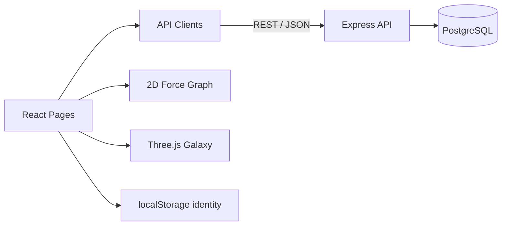

# Stellar Archive Frontend

Stellar Archive 是以「星際探索」為視覺語言的 AI Skill / Prompt 知識庫。每個主題是 Galaxy，每個 Skill / Prompt 是 Planet；使用者可透過 2D 星圖與 3D 銀河探索內容、查看來源資訊並建立自己的 Voyage Map。

> 這是 Andy Lin 的個人作品集版本，源自 2026NodeClass 團隊專案。原始團隊專案與完整成員分工請見[來源與貢獻](#來源與貢獻)。

## 產品功能

- 首頁即時讀取 Catalog API，顯示真實資料筆數與服務狀態。
- Canvas 2D 星圖，可依 galaxy、type 與 keyword 篩選。
- Three.js 3D 銀河探索。
- Planet Detail 顯示內容、相關項目及可追溯的信任資訊。
- 註冊、登入、收藏、Voyage Map 與管理端 CRUD。
- API 失敗時提供 loading / error 狀態，不用靜態假資料掩蓋問題。

## 技術重點

| 分類 | 技術 |
| --- | --- |
| Framework | React 19、Vite 8 |
| Routing | react-router-dom 7 |
| API | Fetch、Axios、JWT Bearer Token |
| 3D / Animation | Three.js、GSAP、@gsap/react |
| Visualization | Canvas、自製力導向星圖 |
| Delivery | GitHub Pages、GitHub Actions |
| Quality | oxlint、Vite production build、來源 SHA |

## 已完成的老師建議優化

- 首頁與 Explore 共用後端 Catalog API，不再出現首頁顯示正常、Explore 卻無資料的矛盾狀態。
- 每個 Galaxy 的筆數由 API 即時計算，失敗時清楚顯示 `CATALOG UNAVAILABLE`。
- Planet Detail 加入作者、原始來源、授權、相容 Agent、版本與更新時間。
- Production build 內嵌 Git commit SHA，首頁可直接辨識線上版本。
- Pull Request 與 `main` push 自動執行 lint 和 production build。

## 架構



```text
src/
├── api/                     # Catalog / favorites API clients
├── hooks/                   # Identity / favorites state
├── components/              # 共用 HUD、星空、游標與導覽
├── pages/
│   ├── Home.jsx             # 即時目錄狀態與動態筆數
│   ├── Explore.jsx          # 2D 星圖與資料篩選
│   ├── Galaxy3D.jsx         # 3D 銀河
│   ├── PlanetDetail.jsx     # 內容、來源 metadata、收藏
│   ├── VoyageMap.jsx        # 個人收藏
│   └── AdminConsole.jsx     # 管理後台
└── App.jsx                  # Routes
```

## 本機開發

需求：Node.js 20+。

```bash
npm ci
npm run dev
```

環境變數：

```dotenv
VITE_API_URL=http://localhost:3010/api
VITE_BASE_URL=/
VITE_SOURCE_COMMIT=local
```

提交前驗證：

```bash
npm run lint
npm run build
```

## Andy Lin 負責內容

Andy 負責將 Explore 與 PlanetDetail 從靜態資料改為真實 PostgreSQL 後端資料：

- 建立 `src/api/catalog.js`，集中處理 API base URL、JSON 解析與錯誤。
- 以 `Promise.all` 並行取得 galaxies 與 planets。
- 讓 2D 星圖、節點數量、galaxy filter 與詳情頁由 API 動態產生。
- 使用 route parameter 載入單一 planet 與同 galaxy 相關內容。
- 使用 `AbortController` 防止已卸載頁面更新 state。
- 加入 loading、API failure 與找不到資料的 UI 狀態。
- 本次個人作品集版本補上首頁資料一致性、信任 metadata、CI 與來源 SHA。

可驗證的原始貢獻：

- [Frontend commit `83372df`](https://github.com/2026NodeClass/frontend/commit/83372df2934e2554d1a825cd31b3d196c3eb1e5d)
- [Frontend PR #2](https://github.com/2026NodeClass/frontend/pull/2)
- [Backend commit `f6b6036`](https://github.com/2026NodeClass/backend/commit/f6b6036b486d8358124a9e93deb57af6996b2325)
- [Backend PR #1](https://github.com/2026NodeClass/backend/pull/1)

## 如何使用 Vibe Coding

Andy 將 AI 當成 codebase 導讀、初稿實作與 review 輔助，而不是取代判斷：

1. 先讓 AI 閱讀 schema、seed、entities 與既有資料，找出前後端命名差異。
2. 把工作拆成 backend catalog API 與 frontend integration 兩個可驗收範圍。
3. 人工決定 SQL 安全、HTTP status、response shape 與 React request lifecycle。
4. AI 協助產生 route / controller / client 初稿，再逐行檢查 diff 與責任範圍。
5. 以 migration、seed、Node tests、lint、production build 與 smoke test 驗證。
6. 用 Git 歷史與原始 PR 誠實區分個人與團隊成果。

## 來源與貢獻

本版本保留原始 Git 歷史，不把團隊成果包裝成個人獨作。原始專案：

- [2026NodeClass/frontend](https://github.com/2026NodeClass/frontend)
- [2026NodeClass/backend](https://github.com/2026NodeClass/backend)

| 成員 | 可驗證的主要範圍 |
| --- | --- |
| Andy Lin | 公開 Catalog API、Explore / PlanetDetail 串接、個人作品集強化 |
| SuMaoXiong | 資料庫與管理端、動畫與整合 |
| JeremyC8891 | 註冊登入、登出與需登入權限處理 |
| YinChe | Three.js 3D 銀河與 VoyageMap 整合 |

## 後續可延伸

- 以 dynamic import 拆分 Three.js 與管理端，降低初始 bundle。
- 補 React component / integration tests，涵蓋搜尋、API failure 與收藏。
- 統一 Fetch / Axios 的錯誤格式與 token handling。
- 增加可及性檢查與鍵盤操作測試。
